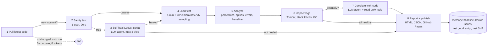

# perf-agent-lab

An **agentic performance-testing pipeline**. Every night (or on demand) it pulls the latest code of a real web application ([JPetStore](https://github.com/mybatis/jpetstore-6)), proves the load-test script still works, **repairs it with an LLM agent when it doesn't**, runs a 1-minute load test, and turns the numbers into a report that links latency spikes and errors to **logs, source code and recent commits**. It runs entirely on GitHub Actions and publishes the report to GitHub Pages.

Built as a portfolio project: [abhisheksinghpawar.com/Ai.html](https://abhisheksinghpawar.com/Ai.html).



## Steps

| # | Step | Type | What happens |
|---|------|------|--------------|
| 1 | **Pull latest code** | code | `git fetch` of the target repo, compare HEAD with the last tested SHA, list changed files. Same SHA as last time means the run stops here. |
| 2 | **Sanity test** | code | Build and start the app (Maven + Tomcat), then Locust with **1 user for 20 s**. Checks status codes, expected page content, error rate and p95. |
| 3 | **Self-heal the script** | **agent** | Only if step 2 fails. The agent can read the script, fetch live pages from the app, and submit a replacement Locust script. Each proposal is validated, then smoke-tested again. Max 3 attempts. A script that passes becomes the new known-good one. |
| 4 | **Run the load test** | code | Default **100 users for 60 s** over four journeys (browse, search, add to cart, sign-in-to-order checkout). `psutil` samples host CPU, memory, network and the Tomcat JVM every second. |
| 5 | **Analyze results** | code | p50/p90/p95/p99, throughput, error clusters, **latency spikes** (rolling median per 5 s bucket) and comparison with a baseline built from earlier runs. |
| 6 | **Inspect logs** | code | Parses Tomcat/JUL output, stack traces (with the first *application* frame), MyBatis SQL context and JVM GC pauses; aligns them with the load timeline. |
| 7 | **Correlate with code** | **agent** | Only if something is anomalous. The agent sees a compact evidence bundle and read-only tools (`get_spike`, `get_exceptions`, `get_log_window`, `get_resource_window`, `find_handler`, `grep_code`, `read_file`, `git_log`). A rule-based fallback produces the same output without an LLM. |
| 8 | **Final report** | code | A single self-contained HTML file (inline SVG charts, no JavaScript): KPIs, response-time / throughput / CPU / network / JVM-memory charts, per-endpoint table, spikes, errors, logs, ranked findings with `file:line` links, an improvement plan, the agent trace and token usage. |

## Why it is cheap to run (token-smart by design)

* **6 of 8 steps never call a model.** Statistics, log parsing and charting are plain code.
* **Unchanged code = no run.** The last tested commit is stored in `memory/state.json`.
* **Agents run on demand.** Healing only runs when the sanity test fails; correlation only runs when there is an error, regression or steady-state spike.
* **The model sees evidence, not data.** The correlation agent starts from a ~3 KB JSON bundle (percentiles, top-5 slowest endpoints, spike windows, error clusters, exception + application frame, resource summary), never raw samples or full logs.
* **It remembers.** `memory/` is committed back after each run: per-endpoint baseline (median of recent runs at the same load), known issues (recurring findings are labelled, not re-investigated), the last known-good Locust script, and per-step token costs so the report can say what a skipped step would have cost.
* **Cheap model is fine.** Defaults to Groq `openai/gpt-oss-20b`; any OpenAI-compatible endpoint works (`LLM_BASE_URL`, `LLM_MODEL`, `GROQ_API_KEY` / `LLM_API_KEY`).

## Safety

* The repair agent can **only** submit a Locust script. It is parsed with `ast` and rejected if it imports anything outside a small allow-list (`locust`, `random`, `re`, `time`, `json`, `recorder`, ...), uses `open`/`eval`/`exec`/`os`/`subprocess`/`socket`, accesses dunder attributes, or contains an absolute URL. It must keep `import recorder`. Attempts are capped.
* The application under test is never modified by agents. Correlation tools are read-only and path-confined to the checked-out repo.
* Load is only ever sent to the app the pipeline starts itself on `localhost`.
* Provider error bodies are never written to reports or logs. Secrets live in GitHub Actions secrets.

## Run it on GitHub Actions

1. Push this repo to GitHub.
2. **Settings → Pages → Source: GitHub Actions.**
3. *(Optional, for the agents)* **Settings → Secrets → Actions → `GROQ_API_KEY`** (a free key from console.groq.com works). Without it the pipeline still runs, in deterministic mode with rule-based correlation.
4. **Actions → perf-agent → Run workflow.** Inputs: `force` (run even if no new commits), `demo_heal` (start from a deliberately stale script to watch self-healing), `use_llm`, `users`.

The workflow also runs nightly. The report lands at `https://<user>.github.io/<repo>/` and a small `latest.json` for embedding is published alongside it.

## Run it locally

Requirements: Java 17+, Python 3.11+, Git.

```bash
pip install -r requirements.txt
python -m agent.run --force --no-llm                  # deterministic mode, no API key needed
GROQ_API_KEY=... python -m agent.run --force          # with the agents
python -m agent.run --force --demo-heal               # watch the repair agent fix a stale script
python -m agent.run --set load.users=250 --set load.spawn_rate=50 --force
```

Environment: `PERF_HOME` relocates all mutable state (memory, reports, out, target clone); `PERF_MAVEN_REPO` points Maven at a cache directory.

To exercise the agent plumbing without any API key, start the scripted OpenAI-compatible server in `tests/fake_llm_server.py` and set `LLM_BASE_URL=http://127.0.0.1:8765/v1 GROQ_API_KEY=fake`.

## Configuration (`config.toml`)

| Section | Key | Default | Meaning |
|---|---|---|---|
| `target` | `repo_url`, `branch`, `app_package` | JPetStore, `master` | system under test and which stack frames count as "our" code |
| `smoke` | `users`, `duration_s`, `min_requests`, `max_error_rate`, `p95_ms_limit`, `max_heal_attempts` | 1, 20, 12, 0.0, 2000, 3 | sanity-test pass criteria |
| `load` | `users`, `spawn_rate`, `duration_s` | 100, 20, 60 | the real test |
| `analysis` | `window_s`, `spike_factor`, `spike_min_ms`, `regression_pct`, ... | 5, 2.5, 250, 25 | detection thresholds |
| `llm` | `base_url`, `model`, `api_key_env`, `max_tool_turns` | Groq, gpt-oss-20b, ... | provider settings |

## Repository layout

```
agent/            orchestrator (run.py), LLM client + tool loop (llm.py), memory.py, context.py
agent/skills/     git_sync, app_env, smoke, heal, load_test, metrics, analyze, logs, correlate, report, publish
locust/           locustfile.py (JPetStore journeys), recorder.py (per-request log), broken/ (stale demo script)
memory/           state.json, baseline.json, known_issues.json, locustfile.good.py, token_stats.json  (committed)
reports/          history.json + the last 30 runs (report.html, report.json, trace.json, raw data)  (committed)
tests/            unit + regression tests (incl. a real captured stack trace) and the scripted LLM server
.github/workflows perf-agent.yml (nightly / manual run, publishes Pages), ci.yml (unit tests)
```

## Testing

```bash
python -m unittest discover -s tests -v
```

Covers the statistics, spike detection, log parsing (including a **real stack trace captured from JPetStore**), the self-heal validator, memory, the LLM tool loop, correlation tools, rule-based correlation, and report rendering (including HTML escaping).

## Example finding (from a validation run)

With 250 concurrent users, JPetStore's `POST /order/new (confirm)` returned HTTP 500 for a small share of requests. The pipeline pulled `HsqlException: unique constraint ... PK_ORDERS` out of the log, identified the first application frame (`OrderService.insertOrder`) and the failing `INSERT INTO ORDERS` statement, and pointed at the call that generates the order id (`getNextId("ordernum")`) as the thing to verify: a read-then-increment sequence that is not atomic under concurrency.

## Limitations

* Locust and the application share one machine (a CI runner), so absolute numbers are indicative; the report is for **trends and regressions**, not capacity planning.
* A 1-minute test is a regression check, not an endurance or stress test.
* LLM output is advisory. Findings include evidence and `file:line` links so they can be checked quickly, and the rule-based path never invents causes beyond simple, stated heuristics.

## License

MIT
