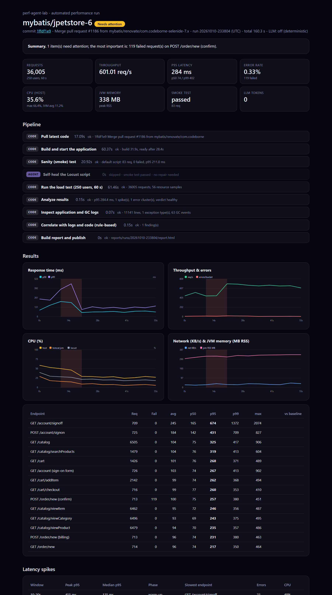
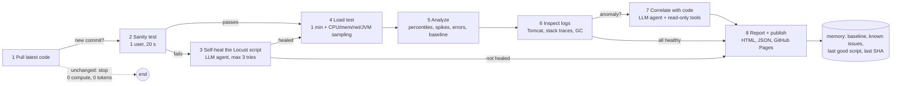

# perf-agent-lab

[](https://github.com/Abhisheksinghpawar/perf-agent-lab/actions/workflows/ci.yml)
[](https://abhisheksinghpawar.github.io/perf-agent-lab/)
[](LICENSE)

**An agentic performance-testing pipeline.** Every night it pulls the latest code of a real web app ([JPetStore](https://github.com/mybatis/jpetstore-6)), proves the load-test script still works, **repairs the script with an LLM agent if it doesn't**, runs a 1-minute load test, and turns the numbers into a report that traces latency spikes and errors to **logs, source code and recent commits**. Everything runs on GitHub Actions and the report is published to GitHub Pages: there is nothing to host.

<p align="center"><a href="https://abhisheksinghpawar.github.io/perf-agent-lab/"></a></p>

> The report above is a real run (rule-based mode, no LLM) of this pipeline against JPetStore at 250 concurrent users. Open the [live report](https://abhisheksinghpawar.github.io/perf-agent-lab/) or the [saved sample](docs/sample-report.html).

## Try it: three ways, easiest first

| | Way | You need | Time |
|---|---|---|---|
| **A** | **Run it on GitHub Actions** (fork, click Run) | a GitHub account | ~5 min, nothing to install |
| **B** | **Local demo, no API key**: full pipeline incl. both agents with a *scripted* model | **Java 21+**, Python 3.11+, git | ~6 min first time (downloads Maven deps) |
| **C** | **Real agents**: same as B with a free Groq key | + `GROQ_API_KEY` | ~6 min |

### A. GitHub Actions (fork and run)

1. **Fork** this repo.
2. **Settings → Pages → Build and deployment → Source: _GitHub Actions_.**
3. *(Optional)* **Settings → Secrets and variables → Actions → New secret** `GROQ_API_KEY` (free key at [console.groq.com](https://console.groq.com)). Without it the pipeline still runs, in rule-based mode.
4. **Actions → perf-agent → Run workflow.** Tick **`demo_heal`** to start from a deliberately broken Locust script and watch the repair agent fix it (needs the key).
5. Your report appears at `https://<your-user>.github.io/perf-agent-lab/`. The workflow also runs nightly and skips itself when the target repo has no new commits.

### B / C. Run locally

```bash
git clone https://github.com/Abhisheksinghpawar/perf-agent-lab && cd perf-agent-lab
pip install -r requirements.txt
python -m agent doctor        # checks Java, Python, ports, network and tells you how to fix anything
python -m agent demo          # B: scripted model, no key. Prints the path of the HTML report when done

export GROQ_API_KEY=...       # C: real agents (PowerShell: $env:GROQ_API_KEY="...")
python -m agent run --force
```

`python -m agent` lists all commands (`doctor`, `demo`, `run`, `test`). Useful flags for `run`: `--no-llm` (rule-based only), `--demo-heal`, `--set load.users=250`, `--force`.

## How it works



| # | Step | Type | What happens |
|---|------|------|--------------|
| 1 | **Pull latest code** | code | `git fetch`, compare HEAD with the last tested SHA, list changed files. Same SHA means the run ends here. |
| 2 | **Sanity test** | code | Build and start the app (Maven + Tomcat), then Locust with 1 user for 20 s. Checks status codes, page content, error rate, p95. |
| 3 | **Self-heal** | **agent** | Only if step 2 fails. The agent reads the script, fetches live pages, and submits a replacement; every proposal is validated and smoke-tested. Max 3 attempts. |
| 4 | **Load test** | code | 250 users for 60 s over four journeys (browse, search, add to cart, sign-in-to-order). `psutil` samples CPU, memory, network and the Tomcat JVM every second. |
| 5 | **Analyze** | code | p50/p90/p95/p99, throughput, error clusters, latency spikes (rolling median) and a comparison with the baseline *at the same load level*. |
| 6 | **Inspect logs** | code | Tomcat output, stack traces (first *application* frame), MyBatis SQL context, JVM GC pauses, aligned with the load timeline. |
| 7 | **Correlate with code** | **agent** | Only if something is anomalous. Read-only tools: `get_spike`, `get_exceptions`, `get_log_window`, `get_resource_window`, `find_handler`, `grep_code`, `read_file`, `git_log`. A rule-based fallback gives the same output without an LLM. |
| 8 | **Final report** | code | One self-contained HTML file (inline SVG charts, no JavaScript): KPIs, charts, endpoint table, spikes, errors, logs, findings with `file:line` links, an improvement plan, agent trace and token usage. |

## Why it is cheap to run

* **6 of 8 steps never call a model.** Statistics, log parsing and charting are plain code.
* **Unchanged code means no run.** The last tested commit is kept in `memory/state.json`.
* **Agents only run when needed.** Healing needs a failed sanity test; correlation needs an error, regression or steady-state spike.
* **The model sees evidence, not data.** The correlation agent starts from a ~3 KB JSON bundle, never raw samples or whole logs.
* **It remembers.** `memory/` is committed back after every run: per-endpoint baselines (per load level), known issues (recurrences are labelled), the last working Locust script, and per-step token costs so the report can say what a skipped step would have cost.
* **Any OpenAI-compatible model works.** Defaults to Groq `openai/gpt-oss-20b`; override with `LLM_BASE_URL`, `LLM_MODEL`, `GROQ_API_KEY`/`LLM_API_KEY`.

## Safety

* The repair agent can **only** submit a Locust script. It is parsed with `ast` and rejected if it imports outside a small allow-list, uses `open`/`eval`/`exec`/`os`/`subprocess`/`socket`, touches dunder attributes or contains an absolute URL. It must keep `import recorder`. Attempts are capped.
* Agents never modify the application under test. Correlation tools are read-only and confined to the cloned repo.
* Load is only ever sent to the app the pipeline starts itself on `localhost`.
* Provider error bodies are never written to reports or logs. Secrets live in GitHub Actions secrets.
* **No third-party code is copied into this repo.** The target app is cloned at run time into a git-ignored folder.

## Reproducibility

* `python -m agent doctor` verifies the machine before anything runs.
* Pin the target with `[target] ref = "<sha or tag>"` in `config.toml` to test exactly the same code every time.
* `python -m agent demo` is deterministic apart from machine timing.
* Mutable state (memory, reports, clone, logs) can be relocated with `PERF_HOME`; Maven's cache with `PERF_MAVEN_REPO`.

## Troubleshooting

| Symptom | Fix |
|---|---|
| `port 8080 is already in use` | Stop the other process (often an earlier, interrupted run) or change `[target].base_url`. |
| `java: not found` / `not in the allowed range [21,22),[25,26)...` | JPetStore's Maven build enforces JDK **21** (or 25+). Install [Temurin 21](https://adoptium.net), put it on `PATH`, re-run `doctor`. |
| First run is slow | Maven downloads Tomcat and dependencies once (~5 min). Later runs reuse the cache. |
| Maven `AccessDeniedException` in `~/.m2` | Two Maven processes ran at once. Run one at a time, or set `PERF_MAVEN_REPO` to a private directory. |
| Actions: *Pages site failed* / deploy job fails | **Settings → Pages → Source** must be **GitHub Actions**. |
| Actions: report didn't change | The target repo had no new commits, so the run was skipped on purpose. Use *Run workflow* with `force`. |
| `No new commits ... nothing to test` locally | Same reason; add `--force`. |
| Self-heal never runs | It needs an LLM key (or `demo`). Without one a failing sanity test ends the run with a clear message. |
| Windows | Works with Git Bash or PowerShell; the Maven wrapper is `mvnw.cmd` and is picked automatically. |

## Configuration (`config.toml`)

| Section | Key | Default | Meaning |
|---|---|---|---|
| `target` | `repo_url`, `branch`, `ref`, `app_package` | JPetStore, `master`, `""` | system under test; pin a commit; which stack frames count as "our" code |
| `smoke` | `users`, `duration_s`, `min_requests`, `max_error_rate`, `p95_ms_limit`, `max_heal_attempts` | 1, 20, 12, 0.0, 2000, 3 | sanity-test pass criteria |
| `load` | `users`, `spawn_rate`, `duration_s` | 250, 50, 60 | the real test |
| `analysis` | `window_s`, `spike_factor`, `spike_min_ms`, `regression_pct`, ... | 5, 2.5, 250, 25 | detection thresholds |
| `llm` | `base_url`, `model`, `api_key_env`, `max_tool_turns` | Groq, gpt-oss-20b | provider settings |

## Repository layout

```
agent/            run.py (orchestrator), llm.py (client + tool loop), memory.py, doctor.py, demo.py, demo_llm.py
agent/skills/    git_sync, app_env, smoke, heal, load_test, metrics, analyze, logs, correlate, report, publish
locust/           locustfile.py (JPetStore journeys), recorder.py (per-request log), broken/ (stale script for the demo)
memory/           state, baselines, known issues, last good script, token stats   (committed back by the workflow)
reports/          history.json + the last 30 runs                                  (committed back by the workflow)
docs/             sample report (HTML + screenshot)
tests/            unit + regression tests, incl. a real captured stack trace
.github/workflows perf-agent.yml (nightly/manual, publishes Pages), ci.yml (tests)
```

## Testing

```bash
python -m agent test
```

Covers statistics and spike detection, log parsing (including a **real stack trace captured from JPetStore**), the self-heal validator, memory/baselines/recurrence, the LLM tool loop, correlation tools, rule-based correlation, and report rendering (including HTML escaping).

## Example finding

At 100-250 concurrent users, JPetStore's `POST /order/new (confirm)` returns HTTP 500 for some requests. The pipeline pulls `HsqlException: unique constraint ... PK_ORDERS` out of the log, identifies the first application frame (`OrderService.insertOrder`) and the failing `INSERT INTO ORDERS`, and points at the line that generates the order id (`getNextId("ordernum")`): a read-then-increment sequence that is not atomic, i.e. a race condition that only shows up under concurrency.

## Limitations

* Locust and the app share one machine (a CI runner), so absolute numbers are indicative; use the report for **trends and regressions**, not capacity planning.
* A 1-minute test is a regression check, not an endurance or stress test.
* LLM output is advisory. Findings carry evidence and `file:line` links so they can be verified quickly, and the rule-based path never claims more than simple, stated heuristics.
* The demo mode proves the agent *plumbing* with a scripted model; it says nothing about how well a real model performs.

## License

MIT
